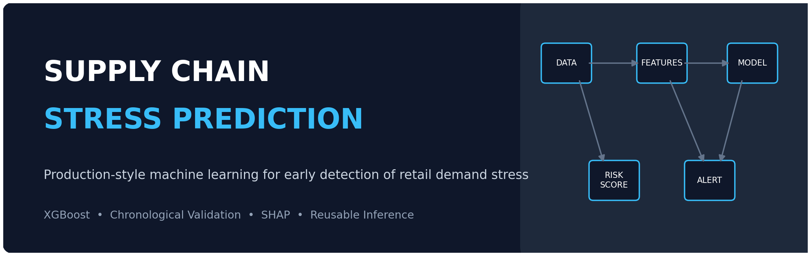
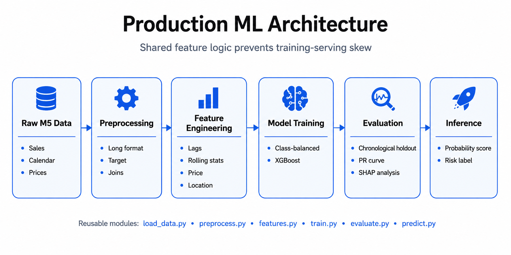
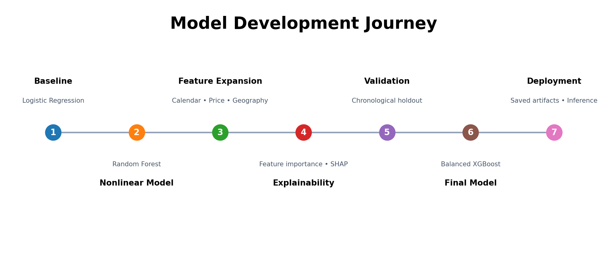
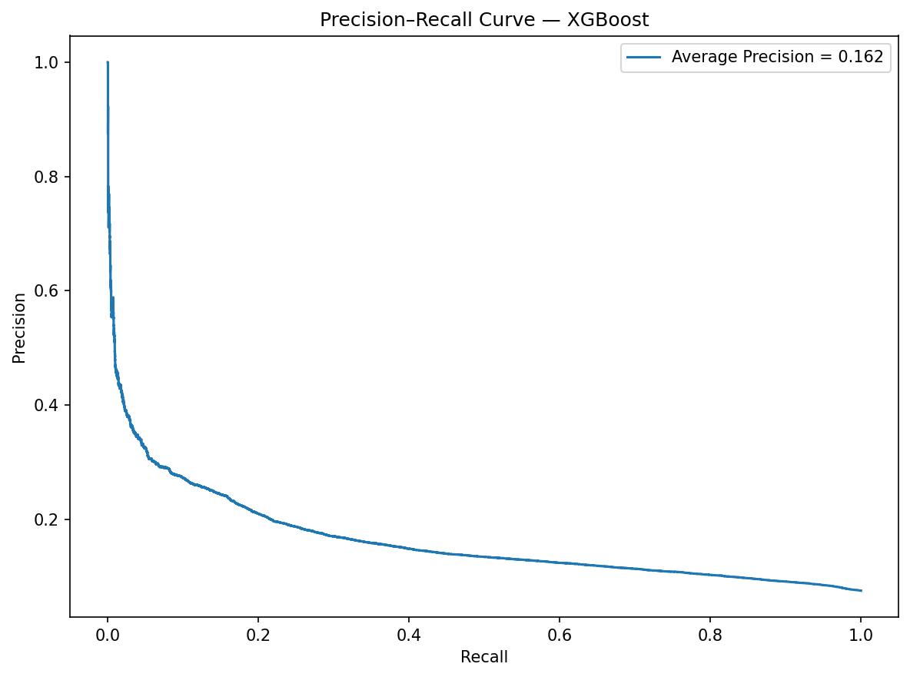
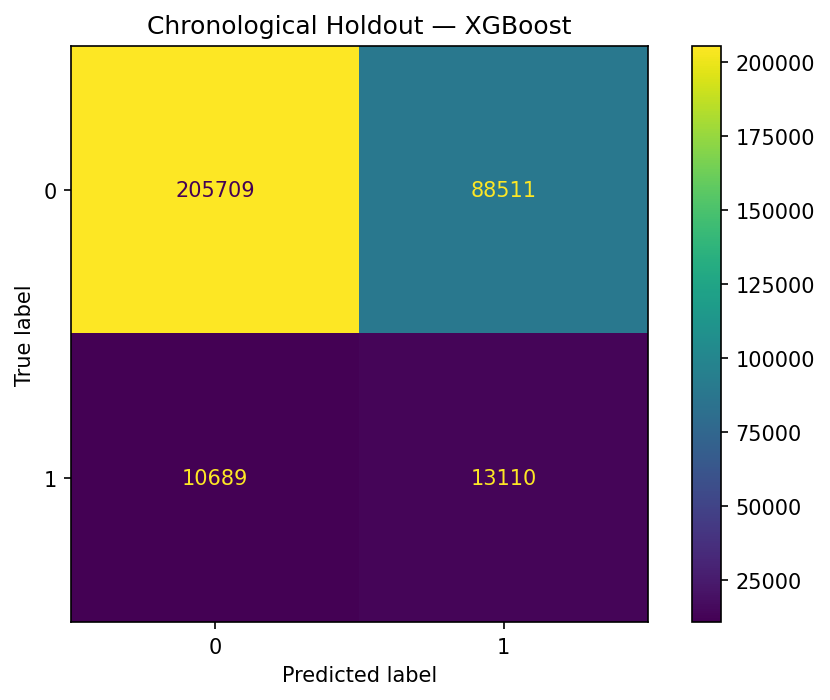
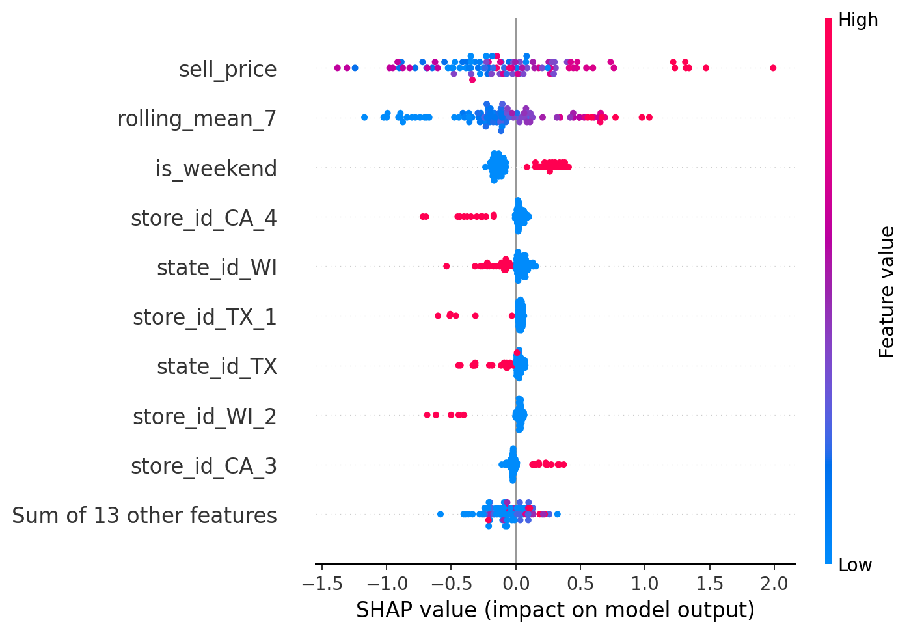

<p align="center">
  
</p>

<p align="center">
  <strong>End-to-end machine learning pipeline for early detection of retail demand stress</strong>
</p>

> **Review comment.** The model predicts a high-sales day for one item in one store. The threshold is the training-period 90th percentile for that item in that store. The data has no stockout label. A high-sales day can occur when the store has the product. The title must agree with this target.

## At a Glance

An early-warning model for retail demand stress (M5 dataset), built and hardened end to end: leakage-safe feature engineering, a FastAPI + Streamlit deployment, Docker/CI, and a dbt/Snowflake warehouse layer.

The headline isn't the model's accuracy — it's what happened when every claim about it got tested instead of assumed:

- **Two data-leakage bugs**, caught only by regression tests, not by holdout metrics that looked fine either way.
- **A confound an external reviewer caught**: the stress label was accidentally measuring store sales *volume*, not genuine demand stress (r=0.85 correlation with volume — corrected, now r=0.03). Verified at 100-item, 5,000-series, and the full 30,490-series catalog.
- **A calibration audit that found the model's "90% confident" alerts were right ~27% of the time** — fixed, and now the actual deployed model, not just a write-up.
- A formal **research paper** documenting the whole investigation, peer-reviewed through several real rounds of revision: [`paper_draft/paper.pdf`](paper_draft/paper.pdf).

> **Review comment.** The paper in this repository is a draft. The revision rounds are not a journal acceptance. Write "draft" on the paper.

📄 **[Read the full case study →](paper_draft/case_study.md)** — the complete investigation, in narrative form, including the bugs, the fixes, and what didn't hold up under scrutiny.

---

## 🚀 Live Demo

<p align="center">

<a href="https://supply-chain-stress-prediction.streamlit.app">

</a>

<a href="https://supply-chain-stress-api.onrender.com/docs">

</a>

<a href="https://github.com/suhailyunus/supply-chain-stress-prediction/actions">

</a>

</p>

**Try it yourself**

1. Open the Streamlit application.
2. Upload `examples/sample_input.csv`.
3. Click **Run Prediction**.
4. Review the dashboard.
5. Download `predictions.csv`.


<p align="center">
  
  
  
  
  
</p>

> A production-oriented machine learning application demonstrating how historical retail demand signals can be transformed into an operational early-warning system through automated feature engineering, REST APIs, containerized deployment, and an interactive web interface.

---


## 📸 Application Preview

### Home Screen

<p align="center">

</p>

### Prediction Results

<p align="center">

</p>

---

## Business Problem

Unexpected demand surges can create inventory pressure, stockouts, and lost sales. This project builds an **early-warning system** that ranks item-store observations by their probability of entering a high-demand state associated with potential supply stress.

The solution uses recent sales behavior, short-term volatility, calendar context, pricing, and location signals to produce a reusable risk score.

## Dataset

The project is built using a large-scale retail sales dataset containing historical product demand, pricing information, promotional calendar events, and multi-store geographic information.

These data sources provide a realistic environment for developing machine learning models that identify elevated demand conditions associated with potential supply chain stress.

The dataset is publicly available and widely used for benchmarking retail demand forecasting methods, making it suitable for demonstrating production-oriented machine learning workflows while maintaining reproducibility.

> **Target caveat:** The retail sales dataset used in this project does not contain verified inventory or stockout outcomes. To approximate supply stress, the target is defined as sales exceeding an item-specific 90th percentile demand threshold. The model therefore predicts a transparent high-demand proxy rather than confirmed stockout events.

> **Review comment.** The shipped threshold uses the item and the store. The threshold does not use the item only. The text above says "item-specific." Change that text so that the text agrees with the shipped threshold.

## Results at a Glance

Stress events occur in **8.85%** of holdout observations. That base rate
is the reference point for everything below: a model that predicts "no
stress" for every row scores **91.15% accuracy** and is useless. Accuracy
is therefore not reported as a headline metric.

**Validation design.** Training covers days 8-1531 (1,208,200 rows);
the holdout covers days 1532-1913 (381,892 rows). No day appears in
both. Every item-store series appears on both sides, so the model is
evaluated on the future of series it has seen - not on unseen items.

> **Review comment.** This table uses the 100-item set. The holdout has 381892 rows for days 1532-1913. That count agrees with 1000 series. 1000 series are 100 items in 10 stores. The full M5 catalog has 30490 series. The volume check uses the full catalog. This precision table does not use the full catalog. Write the sample size next to the table.
>
> The test uses the future days of series in the training data. The test does not use a new item. The test does not use a new store. Keep this limit next to the performance numbers.

### Ranking quality

| Metric | Value | Reference |
|---|---:|---|
| Average precision | **0.2225** | 0.0885 if ranked at random (**2.51x lift**) |
| Precision @ top 100 alerts | **0.520** | 5.9x base rate |
| Precision @ top 1000 alerts | **0.479** | 5.4x base rate |

### Does it beat a heuristic?

The relevant question is not whether the model beats random, but whether
it beats the obvious rule: *flag an item if yesterday's sales were already
above its stress threshold.* Compared at approximately equal alert volume:

| At ~34k alerts | Precision | Recall |
|---|---:|---:|
| Persistence heuristic | 0.2021 | 0.2017 |
| XGBoost (threshold 0.70) | **0.2688** | **0.2806** |

For the same analyst workload, the model produces **33% fewer false
alarms** and catches **39% more stress events**. This is the project's
central result.

### Operating points

The threshold is an operations decision, not a modeling one. Any cutoff
implicitly asserts a cost ratio between a false alarm and a missed event,
and no such ratio exists for this dataset. The curve is the deliverable:

| Threshold | Alerts/day | Precision | Recall |
|---:|---:|---:|---:|
| 0.70 | ~92 | 0.269 | 0.281 |
| 0.75 | ~57 | 0.305 | 0.197 |
| **0.80** | **~30** | **0.355** | **0.120** |
| 0.85 | ~12 | 0.415 | 0.055 |
| 0.90 | ~2 | 0.478 | 0.011 |

**At the time this table was built, the shipped default was the raw score 0.80**,
chosen for reviewability rather than for maximum F1. F1 weights precision and
recall equally, which asserts that a missed event and a false alarm cost the
same; optimizing it yields ~140 alerts per day, a volume unlikely to be
reviewed at all. At 0.80 roughly one alert in three is a real event and one
analyst can clear the queue.

> **Update:** the model was later calibrated (see "Probability Calibration"
> below), and the shipped default is now the calibrated score **0.2801** — the
> calibrated equivalent of this same 0.80 raw cutoff, chosen specifically to
> preserve the same alert volume, not a different operating decision. The
> precision/recall/alert-volume numbers in the table above are unchanged by
> calibration (it relabels scores, it doesn't reorder them), so this table
> remains an accurate description of current behavior; only the specific
> number "0.80" is no longer what you'd pass to reproduce it.

The cost is stated plainly: **recall at this threshold is 0.12, so 29,747
of 33,800 stress events are missed.** This model is a prioritization aid,
not a detection system.

> **Review comment.** The persistence comparison is the correct baseline. The precision changes from 0.202 to 0.269 at the same alert count. The recall at the shipped threshold is 0.12. The model misses most high-sales days. A raw score of 0.90 was correct for 27 percent of alerts. The shipped model uses isotonic calibration. The Brier score changes from 0.2097 to 0.0759. The cutoff 0.2801 keeps the same alert count as the raw cutoff 0.80. Keep these statements.

As of the calibration work described later in this README, scores ARE
genuine calibrated probabilities, not raw ranking values. This was not
always true — `scale_pos_weight` originally shifted raw scores upward by
construction, so a raw "0.80" was a rank cutoff rather than an 80%
likelihood. That claim was tested directly, not just asserted — see
"Probability Calibration" below for the reliability diagrams, what
calibration changed, and what it didn't.

## Engineering Practices

- **Reusable logic in `src/`** rather than only in a notebook, so training
  and inference share the same feature code.
- **Leakage-safe temporal features.** Lags and rolling statistics use
  strictly prior observations, enforced by tests in `tests/test_leakage.py`
  that perturb future values and assert past features are unchanged.
- **Time-based holdout.** The split cuts on `day_num`, so every training
  observation precedes every test observation.
- **Training-period label definition.** The stress threshold is estimated
  from training days only; using the full sample would define labels with
  sales that had not yet occurred.
- **Imbalance-aware modeling** with training-period class weights.
- **SHAP explanations** for feature effect direction and magnitude.
- **Saved feature schema and operating threshold** alongside the model
  artifact, so deployment cannot silently drift from training.

## Architecture

<p align="center">
  
</p>

## Model Development Journey

<p align="center">
  
</p>

## Evaluation Visuals

The `supply_stress_prediction_case_study.ipynb` notebook automatically generates the evaluation figures below during model validation.

### Precision–Recall Curve

<p align="center">
  
</p>

### Confusion Matrix

<p align="center">
  
</p>

### SHAP Summary

<p align="center">
  
</p>

## Repository Structure

```text
.
├── .devcontainer/devcontainer.json            # Reproducible dev environment
├── .github/workflows/ci.yml                   # Lint, tests, and compose smoke test
├── api/
│   ├── main.py                                # FastAPI application
│   └── schemas.py                             # Request and response models
├── artifacts/
│   └── business_impact.json                   # Static holdout cost-impact figures
├── data/raw/                                  # M5 sales, calendar, and pricing data (not tracked)
├── dbt/                                       # Bronze/silver/gold transformation layer (Snowflake)
│   ├── README.md                              # Architecture notes and run instructions
│   ├── dbt_project.yml
│   ├── profiles.yml.example                   # Connection template (real profiles.yml is gitignored)
│   ├── packages.yml
│   └── models/
│       ├── staging/                           # Bronze: typed views over raw Snowflake tables
│       ├── intermediate/                      # Silver: joins + corrected stress target
│       └── marts/                             # Gold: final feature table + data tests
├── docs/images/                               # Interface screenshots
├── examples/
│   ├── sample_input.csv                       # Example batch scoring input
│   └── sample_request.json                    # Example JSON prediction payload
├── frontend/
│   ├── app.py                                 # Streamlit interface
│   └── requirements.txt
├── models/                                    # Generated model artifacts
│   ├── final_xgboost_supply_stress.ubj
│   ├── model_config.json                      # Operating threshold and metadata
│   ├── model_features.json                    # Feature schema contract
│   └── feature_reference_stats.json           # Training feature distribution for drift checks
├── notebooks/
│   └── supply_stress_prediction_case_study.ipynb
├── paper_draft/project_notes.md               # Working notes and design decisions
├── reports/figures/
│   ├── readme_banner.png
│   ├── pipeline_architecture.png
│   ├── model_development_timeline.png
│   ├── precision_recall_curve.png
│   ├── confusion_matrix.png
│   └── shap_summary.png
├── scripts/
│   ├── report_metrics.py                      # Full evaluation report against baselines
│   ├── report_business_impact.py              # Cost-impact report under stated assumptions
│   ├── retrain_and_save.py                    # Retrain, write deployment artifacts, save drift reference
│   ├── snowflake_setup.sql                    # One-time Snowflake account provisioning (warehouse/db/role/user)
│   └── load_raw_to_snowflake.py                # Reshape + load M5 CSVs into Snowflake RAW schema
├── src/
│   ├── load_data.py                           # Raw file loading
│   ├── preprocess.py                          # Analytical table and stress target
│   ├── features.py                            # Leakage-safe temporal features
│   ├── train.py                               # Time-based split and model fitting
│   ├── evaluate.py                            # Metrics and figures
│   ├── predict.py                             # Batch scoring from saved artifacts
│   ├── pipeline.py                            # End-to-end training orchestration
│   ├── monitoring.py                          # KS/PSI input drift detection
│   └── business_impact.py                     # Cost-based threshold evaluation
├── tests/
│   ├── test_api.py                            # API contract tests
│   ├── test_leakage.py                        # Temporal validity regression tests
│   ├── test_business_impact.py                # Cost-calculation correctness tests
│   └── test_drift.py                          # Drift-detection behavior tests
├── Dockerfile                                 # API image
├── Dockerfile.frontend                        # Streamlit image
├── compose.yaml                               # Local API and frontend stack
├── pyproject.toml                             # Tooling configuration
├── requirements.txt                           # Core modeling dependencies
├── requirements-api.txt                       # API runtime dependencies
├── requirements-frontend.txt                  # Streamlit dependencies
├── requirements-dev.txt                       # Test, lint, and optional MLflow dependencies
├── requirements-dbt.txt                       # dbt-core, dbt-snowflake, snowflake-connector-python
├── LICENSE
└── README.md
```

## Feature Engineering

The final feature set includes:

- one-day and seven-day sales lags;
- seven-day rolling mean;
- seven-day rolling standard deviation;
- weekend and event-day indicators;
- state-specific SNAP indicators;
- current selling price and recent price movement;
- one-hot encoded state and store variables.

All demand features are isolated by `item_id` and `store_id`, and rolling features use `shift(1)` to prevent current-row leakage.

## Modeling Approach

1. Reshape retail sales history into an analytical long-format dataset.
2. Construct an item-relative high-demand target.
3. Enrich observations with calendar and price context.
4. Engineer temporal and geographic features.
5. Benchmark Logistic Regression and Random Forest.
6. Tune Random Forest and evaluate feature importance.
7. validate on a time-based holdout, cutting on `day_num` so that every
   training observation precedes every test observation.
8. Benchmark and tune class-balanced XGBoost.
9. Analyze precision-recall trade-offs and thresholds.
10. Persist the model and run reusable inference.

## Installation

```bash
git clone <your-repository-url>
cd supply-chain-stress-prediction
python -m venv .venv
source .venv/bin/activate  # Windows Git Bash
pip install -r requirements.txt
```

Place the retail sales data files inside `data/raw/`:

```text
sales_train_validation.csv
calendar.csv
sell_prices.csv
```

## Train the Model

```python
from src.pipeline import run_training_pipeline

result = run_training_pipeline(
    data_dir="data/raw",
    max_items=100,
    models_dir="models",
)
```

## Run Inference

Inference requires recent historical observations because lag and rolling features cannot be calculated from an isolated row.

```python
from src.predict import predict_supply_stress

# Leaving threshold unset uses the model's saved default (0.2801,
# calibrated -- see "Probability Calibration" below). Passing 0.80
# here would now mean something different than it used to: raw and
# calibrated scores are different scales, and 0.80 is no longer the
# shipped operating point in either scale.
predictions = predict_supply_stress(
    recent_data,
    models_dir="models",
)
```

Example output:

| item_id | store_id | day_num | stress_probability | risk_label |
|---|---|---:|---:|---|
| HOBBIES_1_004 | CA_3 | 1898 | 0.941 | Stress Risk |
| HOBBIES_1_046 | CA_3 | 1913 | 0.935 | Stress Risk |
| HOBBIES_1_023 | TX_2 | 1913 | 0.931 | Stress Risk |

## Key Findings

- Selling price was consistently among the strongest predictive signals.
- Recent demand level and volatility carried most of the remaining signal.
- Weekends increased predicted stress risk.
- An unbalanced XGBoost model achieved high accuracy while detecting
  almost no stress events - the clearest demonstration in this project
  that accuracy is the wrong metric for a rare-event problem.
- Class balancing raised recall substantially, at a large precision cost.
- Threshold changes altered operating behaviour without retraining.
- Precision is roughly flat across the top of the ranking (0.52 at the top
  100 alerts, 0.48 at the top 1000). A sharply-ranked model would be far
  more precise at the very top; this one is not, and no threshold recovers
  precision above ~0.48. This is a real ceiling on the current feature set.
- The train and holdout positive rates differ (0.0752 vs 0.0885). Because
  the threshold is fixed from the training period, this gap reflects
  genuine demand drift rather than an artifact of the label definition.

## Engineering Lessons

- Accuracy is misleading for rare-event classification; the base rate
  belongs next to every reported metric.
- A model is only interesting relative to the cheapest alternative. The
  persistence baseline was more informative than any absolute score.
- Sort order and split logic must be verified together. A positional split
  on an item-sorted table partitions by item while appearing chronological,
  and no metric reveals this - only a test does.
- Label definitions leak too. Feature-level `shift(1)` discipline does not
  help if the target threshold is estimated over the full sample.
- Feature schemas and operating thresholds belong with the model artifact.
- A model can be most useful as a prioritized review queue rather than an
  autonomous decision-maker.
- Plain string and Int64 columns are the default, and both are expensive
  at scale: at ~9.5M rows, uncompressed string columns cost ~1.5GB before
  any join, and Int64 columns holding values that fit in a single byte
  (weekday, month, SNAP flags) cost 8x more than necessary. Categorical
  dtype and explicit downcasting turned an OOM-killed pipeline into one
  that runs in seconds, on the same hardware.
- One-hot encoding a column that's been partitioned to a single category
  (e.g. by chunking on `store_id`) silently produces zero dummy columns —
  no error, no warning. Any chunked-processing pipeline using dummy
  encoding needs a fixed, known category list, not per-chunk inference.
- A single random seed is not a result. The same sampling design produced
  ROI-optimal estimates ranging 2.3x (+$37,850 to +$85,500) across 3
  seeds at 5,000 series; the qualitative direction was stable, the dollar
  figure was not, and reporting only one seed's number would have been
  misleading regardless of which seed got picked.
- External review found a real confound (store-volume/stress-rate
  correlation) that had already been named as an open question in this
  project's own Limitations section but not yet tested. Writing down what
  you haven't checked is only useful if you eventually go check it.

## Limitations

- The target is a proxy for supply stress, not a verified inventory or
  stockout outcome. M5 contains no inventory data.
- **[Resolved, see Validation at Scale] The stress threshold originally
  grouped by `item_id` alone, pooling across stores.** An external review
  (Gemini) flagged that high-volume stores would exceed their item's
  pooled 90th percentile more often by construction — a volume confound,
  not genuine demand stress. Verified empirically (store-level stress
  rate correlated with store sales volume at Pearson r=0.85) and fixed by
  grouping on `(item_id, store_id)` instead. Recall dropped substantially
  once the confound was removed; see Validation at Scale for corrected
  figures.
- **[Resolved, see Validation at Scale] The original workflow sampled the
  first 100 items for computational tractability, unvalidated across the
  full 30,490-series catalog.** Since re-validated on a stratified
  5,000-series sample (3 random seeds) and on the complete 30,490-series
  catalog.
- Recall at the shipped threshold is now 0.03 on the full catalog under
  the corrected target definition (was 0.12 under the flawed one — a
  more honest number, not a regression). Most stress events are missed.
- **[Resolved, see Probability Calibration] Predicted scores are not
  calibrated probabilities.** Tested directly with a reliability diagram
  and Brier score at both 100-item and full-catalog scale. Confirmed
  genuinely miscalibrated at both scales (a raw "0.90" corresponds to
  roughly 25-30% real likelihood, not 90%). Calibration barely changes
  the dollar business-impact conclusion (isotonic/sigmoid calibration
  preserve rank order), but it does mean every threshold number quoted
  in this README should be read as a rank cutoff, not a probability.
- Inventory position, replenishment schedules, supplier lead times,
  weather, and logistics disruptions are absent from the feature set and
  are plausibly more predictive than anything included here.
- Operating thresholds were selected on the holdout. In production they
  should be chosen on a separate validation period to avoid optimistic bias.

## Monitoring & Business Impact

Three additions extend the project from "model that scores well on a
holdout" toward the operational questions a deployed model actually
raises: is training still tracked reproducibly, has the input data
drifted from what the model learned on, and what does the chosen
threshold cost in dollars rather than in precision/recall.

### Experiment tracking

`scripts/retrain_and_save.py --mlflow` logs each run's parameters
(`max_items`, threshold, split day, row counts) and metrics (average
precision, precision/recall at the saved threshold) to a local MLflow
experiment. It's optional and best-effort: a missing `mlflow` package
or an unreachable tracking server logs a warning and does not fail
the retrain.

### Input drift monitoring

`POST /check-drift` compares the feature distribution of a recent
scoring batch against a reference captured from the training set
(`models/feature_reference_stats.json`, regenerated on every retrain).
A feature is flagged only when both a KS test and Population Stability
Index agree — PSI alone is unreliable on small batches, and KS alone
over-triggers on large ones.

**What this does not do:** tell you whether predictions are still
accurate. That requires real outcomes, which aren't available at
scoring time. Drift in an input feature is a prompt to re-validate
against ground truth when it arrives, not a verdict on the model.

### Business impact

`scripts/report_business_impact.py` translates the holdout confusion
matrix into dollar terms under cost assumptions supplied on the
command line — there is no built-in default, because this project has
no verified cost data.

Using a bottom-up estimate grounded in this dataset's actual scale
(average sell price $4.41, ~0.91 units/day per item-store series, so
individual stress events carry single-digit-to-low-double-digit dollar
stakes rather than enterprise-shipment costs) — **$20 per missed
event, $12 per false alarm, $10 per mitigated true positive**:

| | Count |
|---|---:|
| True positives | 4,657 |
| False positives | 8,082 |
| False negatives | 29,143 |

| | Cost |
|---|---:|
| Do-nothing baseline (every event missed) | $676,000 |
| Model at the then-current raw threshold (0.80) | $726,414 |
| Net difference | **-$50,414** |

**At this cost ratio and item price scale, the model costs more than
doing nothing at its then-current threshold.** That threshold (raw 0.80)
was selected to balance precision and recall, not dollar ROI, and the
two do not automatically agree: 8,082 false positives, each carrying a
small but nonzero review cost, outweigh the missed-event cost this
particular ratio assigns. Running `--sweep` finds the ROI-optimal
threshold is much higher (0.95), and even there the best achievable
result is a near-breakeven +$26 — obtained by flagging only 5 of
33,800 stress events. Conservative and moderate cost assumptions did
not find a threshold that beats doing nothing at all; only a more
aggressive cost ratio (FN=$40, FP=$15, TP=$20) found a modestly
positive optimum (+$1,785 at threshold 0.90, catching 387 events).

This is a more useful finding than a manufactured savings number: it
shows that at this dataset's per-item price scale, the alerting
system's business case is fragile-to-negative unless intervention
cost is much lower than a human-review estimate, or the unit of
action is aggregated above single SKU-store-days (e.g., store-level
or category-level decisions). Precision/recall and dollar ROI are
different optimization targets, and conflating them was the central
flaw in an earlier, unreviewed version of this project's business
framing.

`GET /business-impact` serves the evaluated scenario as a static
artifact from the last time the script was run — it is holdout
arithmetic under stated assumptions, not a live production metric.

> **Update:** the figures above were computed on a 100-item sample
> under a target definition later found to have a volume confound (see
> [Validation at Scale](#validation-at-scale)). The qualitative
> conclusion — the shipped threshold loses money, a smaller real
> positive-ROI threshold exists near 0.90 — holds up under correction
> and at full catalog scale, but the exact dollar figures above are
> superseded. Treat this section as the original analysis for
> historical reference, not the current best estimate.

## Validation at Scale

Three questions were still open after the initial 100-item build: does
this generalize past 0.3% of the catalog, does it hold at full scale,
and is the target definition itself sound. All three were tested
directly rather than assumed — including a real confound in the target
definition itself, caught by external review, verified (Pearson r=0.85
→ r=0.03 after correction), and re-validated at every scale below.

| Scale | Target definition | @0.80 net | ROI-optimal |
|---|---|---:|---|
| 1,000-series (original) | pooled by item (flawed) | -$50,414 | 0.95, +$26 |
| 5,000-series (3-seed avg) | pooled by item (flawed) | -$53,158 | ~0.88, +$57,877 |
| 5,000-series | **corrected (item+store)** | -$9,078 | 0.89, +$27,584 |
| 30,490-series (full) | **corrected (item+store)** | **-$209,794** | **0.90, +$47,148** |

The qualitative findings hold under every correction applied: the
shipped threshold consistently costs more than doing nothing, and a
real (smaller, more honestly-earned) positive-ROI threshold exists
around 0.89-0.90.

📄 **[Full narrative →](paper_draft/case_study.md#scaling-past-100-items--and-a-critique-that-held-up)**
— the stratified sampling design, full-catalog processing (including a
silent one-hot encoding bug caught along the way), and how the confound
was found and verified.

## Data Warehouse Layer (dbt + Snowflake)

The pandas/Polars pipeline above is the one that trains and serves the
model. As a separate, parallel exercise, the same transformation logic
— same joins, same corrected leakage-safe stress target, same feature
engineering — was rebuilt as SQL running inside Snowflake, orchestrated
by dbt. Nothing about the model changed; this translates an
already-validated pipeline into a warehouse-native one.

**Why bronze/silver/gold, specifically:**
- **Bronze** (`dbt/models/staging/`): typed, renamed views over raw
  Snowflake tables. No business logic — just "these types can be
  trusted."
- **Silver** (`dbt/models/intermediate/`): the actual transformation.
  Joins sales with calendar/price context, then computes the
  stress-event target — grouped by `(item_id, store_id)`, the corrected
  definition (see "Scaling past 100 items" above), not the flawed
  `item_id`-only pooling that started this whole investigation.
- **Gold** (`dbt/models/marts/`): the final, model-ready feature table.
  Lag/rolling features use `ROWS BETWEEN 7 PRECEDING AND 1 PRECEDING` —
  the SQL equivalent of the `.shift(1).rolling(7)` pattern from the
  original leakage-bug fix, so today's sales still can never leak into
  today's own rolling average. Location is one-hot encoded against a
  **fixed, known category list**, the same fix applied after the
  silent-zero-columns bug found during full-catalog chunked processing.

**What's verified, and how:** loaded and transformed against a real
100-item (1,000-series) sample in a live Snowflake trial account — not
just written and assumed correct. `dbt run` builds all 6 models
successfully; `dbt test` runs 11 automated data-quality checks
(non-null constraints, valid `stress_event` values, and a row-uniqueness
check on `(item_id, store_id, day_num)` that would catch the exact
join-fan-out bug class already found once in the Python full-catalog
work). All 11 pass.

**What's intentionally not done:** this stops at proof-of-concept scale
(100 items), not the full 30,490-series catalog. The validation question
— does the corrected target definition and pipeline logic hold up at
full scale — was already answered rigorously in Python (see "Validation
at Scale" above); re-running the same, already-proven logic bigger in
SQL wouldn't answer a new question, just spend more of a trial account's
compute credits proving the same thing again. There's also no
orchestration (this runs on-demand, not on a schedule) and no
incremental materialization — both straightforward additions if this
became a real production pipeline rather than a portfolio demonstration
of the pattern.

See `dbt/README.md` for architecture notes and full run instructions.

## Probability Calibration

Every limitations section in this project said the same thing for months:
"predicted scores are not calibrated probabilities." That assumption was
never actually tested — until it was, using a three-way chronological
split (train / calibration / final evaluation) so the reported numbers
were never touched by whatever fit the calibrator.

**The claim held up, and the deployed model is fixed as a result, not
just written up as a finding.** A raw "0.90" corresponded to roughly
25-28% real likelihood, not 90%, confirmed at both a 1,000-series and the
full 30,490-series scale. Against the *correct* no-skill reference for a
rare event (`p(1-p)`, not the commonly-misused 0.25), the resulting Brier
Skill Score was real but modest (~0.04-0.05) — an honest, more careful
number than the raw Brier improvement alone would suggest.

| Scale | Prevalence | Reference Brier (`p(1-p)`) | Raw Brier | Calibrated Brier | Brier Skill Score |
|---|---:|---:|---:|---:|---:|
| 1,000 series | 0.093 | 0.084 | 0.235 | 0.081 | 0.039 |
| Full catalog (30,490 series) | 0.127 | 0.111 | 0.227 | 0.105 | 0.048 |

The genuinely interesting part: fixing the mislabeled scores barely moved
the actual business decision (verified by running the code from scratch
twice, not just reasoning it through) — calibration relabels scores, it
doesn't reorder them, so a threshold chosen the same way selects the same
alert set either way. What changed was whether the number could be
trusted as a stated probability, not which decision it implied.

📄 **[Full narrative →](paper_draft/case_study.md#was-the-models-confidence-real-auditing-calibration)**
— the three-way split, why "0.25" is the wrong reference, the ex-ante vs.
oracle distinction, and what deploying the fix actually involved.

Reproducible from `scripts/paper_audit.py` (1,000-series) and
`scripts/train_calibrate_full_catalog.py` (full catalog), with
machine-readable outputs in `paper_draft/generated/`.
`scripts/deploy_calibrated_model.py` is what actually shipped it: the
deployed model is `CalibratedClassifierCV` (see `models/model_config.json`),
threshold `0.2801` (calibrated equivalent of the old raw `0.80`, chosen
to preserve the same alert volume).

## Model Comparison

XGBoost was the model used from the start of this project, without ever
being tested against alternatives. It's since been compared against
LightGBM, CatBoost, and a logistic regression baseline, under the same
three-way chronological split and oracle-vs-ex-ante discipline as the
calibration work above.

| Model | AP (raw scores) | BSS (calibrated) | Ex-ante net | Oracle net |
|---|---:|---:|---:|---:|
| XGBoost | 0.179 [0.166, 0.186] | 0.036 [0.028, 0.039] | +$23 [0, 70] | +$41 [0, 104] |
| CatBoost | 0.182 [0.182, 0.183] | 0.036 [0.036, 0.037] | -$10 [-54, 16] | +$38 [34, 46] |
| LightGBM | 0.150 [0.147, 0.153] | 0.024 [0.022, 0.025] | $0 [0, 0] | $0 [0, 0] |
| Logistic regression | 0.134 [fixed] | 0.012 [fixed] | $0 [fixed] | $0 [fixed] |

**Verdict:** XGBoost and CatBoost produced higher AP and calibrated BSS
than LightGBM and logistic regression in these fixed-sample runs;
XGBoost and CatBoost themselves are not meaningfully distinguishable —
their ranges overlap, and which one nominally leads is itself sensitive
to the exact software environment. The economic differences are noise
for every model, consistent with the near-breakeven business case at
this scale regardless of model choice. One nuance worth keeping:
LightGBM's *raw*, uncalibrated scores are naturally far closer to honest
than XGBoost's or CatBoost's — better calibrated out of the box, at the
cost of weaker ranking.

📄 **[Full narrative →](paper_draft/case_study.md#does-the-algorithm-choice-matter)**
— including a threshold-search bug this comparison caught in its own
methodology (an "oracle" can never be worse than doing nothing, and an
earlier version of this script didn't enforce that).

Reproducible from `scripts/model_comparison_robust.py`; full numbers in
`paper_draft/generated/model_comparison_robust.json`.

## Future Work

- Replace the proxy target with verified inventory or stockout outcomes.
- Integrate inventory position, supplier lead times, and replenishment schedules.
- Deploy to Azure using managed container services.
- Add a model registry and an automated retraining trigger on detected drift.
- Introduce authentication and role-based access control.
- Support batch inference and scheduled scoring workflows.

## Notebook

The full analytical narrative is available in:

```text
notebooks/supply_stress_prediction_case_study.ipynb
```

The notebook documents the complete analytical workflow, from data preparation and feature engineering through model development, explainability, threshold selection, and production inference. It serves as the technical case study accompanying the modular Python implementation contained within the `src/` package.


## License

Released under the MIT License. See [LICENSE](LICENSE).

## Acknowledgements

This project uses a publicly available retail sales forecasting dataset released for academic benchmarking. The engineering workflow, feature engineering strategy, model development, evaluation methodology, production pipeline, and documentation were developed independently as part of this portfolio project.

---

<p align="center">
  <strong>Built as a production-oriented machine learning portfolio project.</strong>
</p>

## Containerized Prediction API

The final model is exposed through a production-style FastAPI service and packaged as a hardened Docker container. The API loads the saved XGBoost model once at startup, reuses the same feature-engineering code as training, validates incoming history, and returns probability-based risk labels.

### API endpoints

| Endpoint | Method | Purpose |
|---|---|---|
| `/health` | GET | Liveness and model-load status |
| `/ready` | GET | Readiness check used by Docker |
| `/model-info` | GET | Model type, thresholds, and feature schema |
| `/predict` | POST | Score JSON historical observations |
| `/predict-file` | POST | Upload and score a CSV file |
| `/check-drift` | POST | Compare a recent batch to the training feature distribution |
| `/business-impact` | GET | Serve holdout cost-impact figures from the last offline evaluation |
| `/docs` | GET | Interactive Swagger documentation |

### Build and run with Docker Compose

```bash
docker compose up --build
```

Open the interactive API documentation:

```text
http://localhost:8000/docs
```

Check service readiness:

```bash
curl http://localhost:8000/ready
```

Submit the included example request:

```bash
curl -X POST http://localhost:8000/predict \
  -H "Content-Type: application/json" \
  --data @examples/sample_request.json
```

Stop the service:

```bash
docker compose down
```

### Container security and reproducibility

- Multi-stage image build separates dependency installation from runtime.
- The service runs as a non-root user.
- The container filesystem is read-only under Compose.
- Linux capabilities are dropped and privilege escalation is disabled.
- Model readiness is monitored through an HTTP health check.
- Runtime dependencies are pinned via a compiled lockfile
  (`requirements-api.lock.txt`), with a CI check that fails the build if
  the lockfile ever drifts from its source `requirements-api.txt`.
- `.dockerignore` excludes notebooks, data, development caches, and other non-runtime files.

### Run API tests locally

```bash
pip install -r requirements-dev.txt
pytest -q
```

## Download Business-Ready Predictions as CSV

The API includes a CSV-download endpoint for non-technical users:

```text
POST /predict-file-csv
```

From the Swagger interface at `http://localhost:8000/docs`:

1. Open **POST /predict-file-csv**.
2. Select **Try it out**.
3. Upload `examples/sample_input.csv`.
4. Leave the threshold blank to use the saved default (`0.2801`, calibrated).
5. Select **Execute**, then use the response **Download file** link.

The downloaded `predictions.csv` contains:

- item and store identifiers;
- model probability;
- binary stress prediction;
- operational label (`No Stress` or `Stress Risk`);
- business severity level (`Low`, `Moderate`, `High`, or `Critical`).

Risk bands are derived from the configured alert threshold rather than
from fixed cutoffs, so that severity and the alert decision stay aligned
if the operating point is retuned. `High` and `Critical` always
correspond to a raised alert; `Low` and `Moderate` never do.

| Score | Business risk level | Alert raised |
|---|---|---|
| `< threshold / 2` | Low | No |
| `threshold / 2` to `threshold` | Moderate | No |
| `threshold` to midpoint of the remaining range | High | Yes |
| above that midpoint | Critical | Yes |

At the shipped threshold of `0.2801` (the calibrated equivalent of the
originally-chosen `0.80` raw cutoff -- see "Probability Calibration"
above for why the number changed but the alert volume didn't) this
resolves to:

| Score | Business risk level | Alert raised |
|---:|---|---|
| `< 0.14` | Low | No |
| `0.14–0.28` | Moderate | No |
| `0.28–0.64` | High | Yes |
| `>= 0.64` | Critical | Yes |

As of the calibration work described above, these scores ARE genuine
calibrated probabilities, not raw ranking values -- e.g. a score of
`0.28` really does mean roughly a 28% chance of a stress event, not an
arbitrary rank cutoff. This is a change from this model's original
behavior; older references to "scores are not calibrated" elsewhere in
this README describe that prior, now-fixed state and are kept for the
historical record.

## Web Interface

The project includes a Streamlit interface that sits in front of the FastAPI inference service. Users can upload a CSV, preview the input, run predictions, review business-friendly risk levels, inspect the highest-risk observations, and download `predictions.csv`.

Run both services with Docker Compose:

```bash
docker compose up --build
```

Open:

- Web application: `http://localhost:8501`
- FastAPI documentation: `http://localhost:8000/docs`

The frontend calls the API over the internal Docker network:

```text
Browser → Streamlit → FastAPI → feature engineering → XGBoost → predictions.csv
```

Use `examples/sample_input.csv` for a quick end-to-end test. Each item-store series needs at least eight chronological rows because the inference pipeline reconstructs lag and rolling features before scoring.

## Continuous Integration

The repository includes a GitHub Actions workflow at `.github/workflows/ci.yml`. It runs automatically for pushes and pull requests targeting `main`.

The workflow performs two stages:

1. **Python verification** — installs the development dependencies, compiles the Python modules, and runs the automated API tests.
2. **Container smoke test** — validates `compose.yaml`, builds both Docker images, starts the FastAPI and Streamlit services, and checks their health endpoints.

After pushing the workflow, open the repository's **Actions** tab to view the run. A successful run confirms that the tested code and both containerized services can start cleanly in a fresh environment.

> This workflow provides continuous integration. Continuous deployment will be added after selecting the public hosting target for the API and web interface.


---

## 🌐 Live Links

- **Web Application:** https://supply-chain-stress-prediction.streamlit.app/
- **Interactive API Documentation:** https://supply-chain-stress-api.onrender.com/docs
